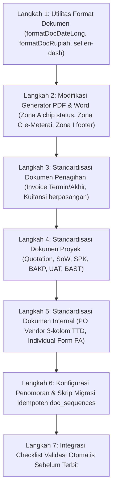

# Laporan Audit Modul Dokumen Altcycles (Tahap 0)

Tanggal Audit: 14 November 2026  
Auditor: Antigravity Assistant (AI Systems Engineer)  
Referensi Utama: `docs/standar-dokumen.md` & Basis Kode Altcycles (ERP Keuangan Altvira)

---

## Ringkasan Eksekutif

Audit Tahap 0 telah selesai dilakukan pada seluruh modul dokumen, alur transaksi, model basis data, dan mesin generator PDF/Word di Altcycles. Sistem yang berjalan saat ini memiliki fondasi yang solid dengan **8 test suite (38 test cases) yang seluruhnya lolos (100% pass)**, arsitektur berbasis peran (Super Admin, Admin/Akuntan, User/Tim, dan Klien Publik via Portal Pembeli), serta penegakan audit trail abadi (*immutable*).

Namun, ditemukan beberapa perbedaan struktural dan bisnis antara standar dokumen baru (`docs/standar-dokumen.md`) dengan sistem berjalan. Di antaranya: pola prefix penomoran dokumen (`ALT/{JENIS}/...` vs `{JENIS}/ALT/...`), periode reset counter (tahunan vs bulanan), pasangan nomor invoice–kuitansi, ketiadaan dokumen mandiri PR (Purchase Requisition) dan cetak individual Payment Approval, ketiadaan ruang e-Meterai otomatis, serta perbedaan format visual tanggal dan angka.

Laporan ini memetakan seluruh kondisi eksisting, menganalisis konflik dan duplikasi, menilai risiko regresi, serta menyusun rencana perbaikan terukur bertahap (Tahap 1 dst.) yang menjamin zero-regression pada sistem yang berjalan.

---

## A. Peta Kode Dokumen yang Ada

Altcycles saat ini mengelola 13 jenis dokumen transaksi dan proyek. Berikut adalah pemetaan menyeluruh untuk tiap jenis dokumen:

| No | Jenis Dokumen | File Template / Pembuat Spesifikasi | Komponen UI | Fungsi Pembuat File | Rute / Endpoint Terkait | Tabel Database Terkait |
|:---|:---|:---|:---|:---|:---|:---|
| 1 | **Quotation (Penawaran Harga)** | `makeQuotationSpec` di `src/features/client-projects/project-detail-page.tsx:600-635` | `DocumentDownloadMenu` di `project-detail-page.tsx:1781` | `generateDocumentPdf`, `generateDocumentWord` | `/admin/proyek/:projectId` (Tab Quotation) | `public.quotations`, `public.quotation_items` |
| 2 | **SoW (Scope of Work)** | `makeSowDocSpec` di `src/features/client-projects/project-detail-page.tsx:653-695` | `DocumentDownloadMenu` di `project-detail-page.tsx:2214` | `generateDocumentPdf`, `generateDocumentWord` | `/admin/proyek/:projectId` (Tab Dokumen) | `public.project_documents` (`doc_type = 'SOW'`) |
| 3 | **SPK (Project Charter / Kontrak)** | `extractSpkCharterContent` di `src/lib/spk-defaults.ts` & `SpkCharterFields` di `src/components/shared/spk-charter-fields.tsx` | `DocumentDownloadMenu` di `project-detail-page.tsx:2214`, Form `SpkCharterFields` | `generateSpkProjectCharterPdf`, `generateSpkProjectCharterWord` | `/admin/proyek/:projectId` (Tab Dokumen & SPK) | `public.project_documents` (`doc_type = 'SPK'`) |
| 4 | **PO Klien (Purchase Order Pelanggan)** | `buildClientPoPdfSpec` di `src/lib/pdf-generator.ts:1561-1634` | Tombol download PDF di `buyer-portal-page.tsx:250`, `project-detail-page.tsx:1985` | `generateDocumentPdf` | `/portal-pembeli`, `/admin/proyek/:projectId` (Tab PO Klien) | `public.client_purchase_orders`, `public.po_access_logs` |
| 5 | **PO Internal (Pembelian ke Vendor)** | Spesifikasi inline di `src/features/purchase-orders/po-page.tsx:210-249` | Tombol download PDF di `po-page.tsx:467`, `ExportDownloadMenu` di `po-page.tsx:354` | `generateDocumentPdf` (Word belum ada) | `/admin/po-internal`, `/user/po` | `public.purchase_orders`, `public.po_items`, `public.purchase_order_status_logs` |
| 6 | **PR (Purchase Requisition)** | **Belum ada** (alur pengadaan internal saat ini menggunakan Payment Request atau draf PO Internal) | Belum ada | Belum ada | Belum ada | Belum ada tabel `purchase_requisitions` |
| 7 | **BAKP (Kemajuan Pekerjaan)** | `makeBakpSpec` di `src/features/client-projects/project-detail-page.tsx:743-768` | `DocumentDownloadMenu` di `project-detail-page.tsx:2412` | `generateDocumentPdf`, `generateDocumentWord` | `/admin/proyek/:projectId` (Tab Milestone & BAKP) | `public.progress_reports`, `public.milestones` |
| 8 | **Invoice Termin** | `buildInvoicePdfSpec` di `src/lib/pdf-generator.ts:1443-1519` via `makeInvoiceSpec` di `invoicing-page.tsx:350` | `DocumentDownloadMenu` di `invoicing-page.tsx:787` & `project-detail-page.tsx:2579` | `generateDocumentPdf`, `generateDocumentWord` | `/admin/penagihan`, `/admin/proyek/:projectId` (Tab Invoice) | `public.sales_invoices`, `public.invoice_items` |
| 9 | **Kuitansi (Bukti Pembayaran)** | `buildReceiptPdfSpec` di `src/lib/pdf-generator.ts:1524-1556` via `makeReceiptSpec` di `invoicing-page.tsx:392` | `DocumentDownloadMenu` di `invoicing-page.tsx:952` & `project-detail-page.tsx:2760` | `generateDocumentPdf`, `generateDocumentWord` | `/admin/penagihan` (Tab Kuitansi), `/admin/proyek/:projectId` | `public.receipts`, `public.invoice_payments` |
| 10 | **UAT (Checklist Pengujian)** | `makeUatSpec` di `src/features/client-projects/project-detail-page.tsx:784-818` | `DocumentDownloadMenu` di `project-detail-page.tsx` (Tab UAT) | `generateDocumentPdf`, `generateDocumentWord` | `/admin/proyek/:projectId` (Tab UAT) | `public.uat_checklists`, `public.uat_items` |
| 11 | **BAST (Serah Terima)** | `makeBastSpec` di `src/features/client-projects/project-detail-page.tsx:834-859` | `DocumentDownloadMenu` di `project-detail-page.tsx` (Tab BAST) | `generateDocumentPdf`, `generateDocumentWord` | `/admin/proyek/:projectId` (Tab BAST) | `public.handover_reports` |
| 12 | **Invoice Akhir (Pelunasan)** | `buildInvoicePdfSpec` dengan `invoice_kind = 'final_settlement'` | `DocumentDownloadMenu` di `invoicing-page.tsx:787` | `generateDocumentPdf`, `generateDocumentWord` | `/admin/penagihan`, `/admin/proyek/:projectId` | `public.sales_invoices` (`invoice_kind = 'final_settlement'`, referensi `bast_id`) |
| 13 | **Payment Approval (Internal)** | Hanya ekspor daftar tabel di `admin-approvals-page.tsx:271-300`, belum ada spesifikasi individual | `ExportDownloadMenu` di `admin-approvals-page.tsx:354` | `generateDocumentPdf` (hanya cetak tabel list) | `/admin/persetujuan`, `/user/pembayaran` | `public.payment_requests`, `public.attachments` |

---

## B. Aturan Sistem yang Sudah Berlaku

Aturan-aturan berikut telah tertanam kuat di skema database, RLS policies, trigger atomik, dan logika frontend:

### 1. Pola Penomoran Dokumen
- **Fungsi Database:** `public.next_doc_number(p_doc_type, p_doc_date)` di `supabase/migrations/0002_core_identity_and_audit.sql:141-193` dan `src/lib/data-service.ts:1111-1133`.
- **Konfigurasi Prefix:** Disimpan di tabel `public.doc_sequences` (`prefix_pattern`, `padding_digits`, `reset_period`).
- **Pola Default Eksisting:** `{JENIS}/ALT/{{tahun}}/{{bulan}}/{{urut}}` (contoh: `INV/ALT/2026/11/001`), dengan `padding_digits = 3` dan `reset_period = 'monthly'`.
- **Pencacah Atomik:** Disimpan di `public.doc_sequence_counters` dengan kunci `(doc_type, period_key)`. Kunci periode bulanan berformat `YYYY-MM`.
- **Nomor PO Klien Khusus:** `public.generate_client_po_number(p_doc_date)` di `0002_core_identity_and_audit.sql:196-217` menghasilkan pola `'PO-' || to_char(p_doc_date, 'YYYYMM') || '-' || v_code` (6 karakter acak non-ambigu `ABCDEFGHJKLMNPQRSTUVWXYZ23456789`).

### 2. Status dan Transisi Dokumen
- **Quotation:** `draft` -> `sent` -> `accepted` | `rejected` | `expired` (`src/types/database.types.ts:107`, `project-detail-page.tsx:507-550`).
- **PO Klien:** `pending_verification` -> `verified` | `rejected` (`database.types.ts:108`, `project-detail-page.tsx:1924-1970`).
- **SoW / SPK (Project Document):** `is_signed` boolean (Draf Review -> Ditandatangani Sah) (`database.types.ts:639`, `project-detail-page.tsx:681`).
- **Milestone Proyek:** `planned` -> `in_progress` -> `bakp_approved` -> `invoiced` -> `paid` (`database.types.ts:109-114`).
- **BAKP:** `draft` -> `approved_by_client` (`database.types.ts:115`, `project-detail-page.tsx:2340-2380`).
- **UAT Checklist:** `conclusion`: `pending` -> `accepted` | `accepted_with_notes` | `rejected` (`database.types.ts:116-120`). Item UAT: `pending` -> `pass` | `fail`.
- **BAST:** `draft` -> `signed` (`database.types.ts:121`, `project-detail-page.tsx:2690-2720`).
- **Sales Invoice:** Memiliki dua dimensi status:
  - `doc_status`: `draft` -> `issued` -> `cancelled`.
  - `payment_status`: `unpaid` -> `partial` -> `paid` -> `cancelled` (`database.types.ts:123-124`, `invoicing-page.tsx:176-260`).
- **PO Internal:** `draft` -> `issued` -> `completed` | `cancelled` (`database.types.ts:74`, `po-page.tsx:160-202`). Riwayat dicatat di `purchase_order_status_logs`.
- **Payment Request (PA):** `draft` -> `submitted` -> `approved` | `rejected` -> `paid` (`database.types.ts:75-80`, `admin-approvals-page.tsx:180-234`).

### 3. Otorisasi dan Alur Persetujuan (RBAC)
- **Super Admin:** Mengelola pengaturan global, profil perusahaan, urutan penomoran (`doc_sequences`), template dokumen (`doc_templates`), manajemen user & multi-peran, serta audit trail (`src/app/role-guard.tsx`, `0004_phase1_rls_policies.sql`).
- **Admin (Bendahara / Akuntan):** Menyetujui Payment Request (`PA`), menerbitkan PO internal ke vendor, memverifikasi PO Klien, menerbitkan Sales Invoice, mencatat pembayaran & kuitansi, memposting jurnal, mengunci periode buku (`0004`, `0005`, `0007`).
- **User (Anggota Tim):** Mengajukan Payment Request (`user-payments-page.tsx`), membuat draf PO internal (`po-page.tsx:mode="user"`). Dilarang menyetujui transaksi atau posting jurnal.
- **Klien / Pembeli Publik:** Akses publik khusus portal pembeli tanpa login (`/portal-pembeli`), dibatasi hanya untuk melihat PO miliknya dan dokumen yang ditandai `visible_to_buyer = true`.

### 4. Rumus Total, Pajak, dan Pembulatan
- **Pembulatan Rupiah:** `roundRupiah(val) = Math.round(val)` tanpa sen (BR-11, `src/lib/formatters.ts:21-27`).
- **Aturan Non-PKP Altvira:** `company_profile.pkp_enabled` default `false`. Jika `false`, `ppn_amount = 0`, total tagihan = subtotal tanpa baris PPN (`0002_core_identity_and_audit.sql:105-107`, `0018_accounting_pkp_ppn_and_verify_po.sql`).
- **Jika PKP Aktif:** PPN dihitung berdasarkan tarif `company_profile.ppn_rate` (default 11%).
- **Terbilang:** `terbilangRupiah(amount)` mengonversi nilai numerik ke bahasa Indonesia huruf kapital awal diakhiri "rupiah" (`src/lib/formatters.ts:173-181`).

### 5. Aturan Termin dan Pengakuan Pendapatan
- **Metode Pengakuan Otomatis:** `inferRevenueMethodFromTerms(count)` (`src/lib/formatters.ts:186-194`):
  - 1 termin: `single_term_deferral` (pendapatan ditangguhkan di muka, diakui saat BAST).
  - 2 termin: `two_term_accrual` (akrual akhir tahun + pembalik).
  - ≥ 3 termin: `progress_billing` (menggunakan akun Piutang Belum Ditagih / Contract Asset & Penagihan Kontrak / Contract Liability berbasis capaian BAKP kumulatif).
- **Integritas Termin:** Total persentase milestone wajib tepat 100% dan total nilai sama dengan nilai kontrak proyek (`0007_phase4_...sql`).

### 6. Akses Portal Pembeli Tanpa Login
- Lookup nomor PO melalui edge function `buyer-portal-lookup` memanggil RPC `rpc_buyer_lookup_po` (`supabase/functions/buyer-portal-lookup/index.ts`).
- Rate limiting berbasis hashing IP (`ipHash`) maks 10 request per 15 menit.
- Sanitasi data ketat: Klien hanya menerima data 1 PO yang cocok, milestones terkait, dan dokumen dengan flag `visible_to_buyer = true`.

### 7. Validasi yang Sudah Berjalan
- Tanggal jatuh tempo invoice tidak boleh sebelum tanggal invoice (`due_date >= invoice_date`).
- Masa berlaku quotation tidak boleh sebelum tanggal penawaran (`valid_until >= quotation_date`).
- Penerbitan invoice termin progresif wajib memiliki BAKP yang sudah disetujui klien (`status = 'approved_by_client'`).
- Penerbitan invoice pelunasan akhir (`final_settlement`) wajib merujuk BAST yang sudah ditandatangani (`bast_id IS NOT NULL`).
- Kuitansi hanya bisa diterbitkan setelah adanya pembayaran tercatat (`invoice_payments`).

---

## C. Tabel Perbandingan: Standar vs Kondisi Sekarang

| No | Butir Standar (`standar-dokumen.md`) | Status | Lokasi Kode Sekarang | Catatan & Analisis |
|:---|:---|:---|:---|:---|
| **1** | **Elemen Wajib Invoice** | | | |
| 1.1 | Judul "INVOICE", bukan "Faktur" | Sudah Sesuai | `pdf-generator.ts:1470` | Judul saat ini "INVOICE PENAGIHAN". Perlu disederhanakan menjadi "INVOICE". |
| 1.2 | Nomor invoice unik dan berurut | Sudah Sesuai | `0002_core_identity_and_audit.sql:141` | Menggunakan sequence counter DB atomik. |
| 1.3 | Tanggal terbit, jatuh tempo, termin | Sudah Sesuai | `pdf-generator.ts:1473, 1485` | Tanggal terbit & jatuh tempo tercantum. Default jatuh tempo 7 hari (standar minta 14 hari). |
| 1.4 | Identitas penerbit lengkap (Nama, Alamat, Kontak, NPWP bila ada) | Sudah Sesuai | `pdf-generator.ts:399-432` | Kop perusahaan memuat nama, legal entity, alamat, email, telepon. NPWP ada di DB (`tax_id`) namun belum ditampilkan di kop. |
| 1.5 | Identitas penerima lengkap (Nama legal, Alamat, PIC, NPWP) | Sebagian | `pdf-generator.ts:1476-1481` | Nama, PIC, dan alamat tercantum. NPWP klien belum ditarik ke spec invoice. |
| 1.6 | Rujukan dokumen induk (PO Klien, SPK, Termin, BAST/BAKP) | Sebagian | `pdf-generator.ts:1484` | Referensi PO Klien sudah ada. Rujukan nomor SPK dan nomor BAST/BAKP belum eksplisit di meta rows. |
| 1.7 | Periode layanan / tanggal serah | Belum Ada | `pdf-generator.ts:1482-1486` | Belum ada baris periode layanan di invoice termin. |
| 1.8 | Rincian tabel: No, Deskripsi, Qty, Satuan, Harga Satuan, Durasi, Total | Sebagian | `pdf-generator.ts:1487-1500` | Kolom saat ini: No, Description, Qty, Total. Belum ada kolom Satuan, Harga Satuan, dan Durasi. |
| 1.9 | Subtotal, diskon, total | Sebagian | `pdf-generator.ts:1501-1507` | Subtotal dan Total Amount ada. Belum ada baris Diskon. |
| 1.10 | DPP & PPN non-aktif (Altvira belum PKP) | Sudah Sesuai | `0002_...sql:105`, `pdf-generator.ts:1461` | PPN dinonaktifkan via `pkp_enabled = false`. Catatan non-PKP otomatis muncul. |
| 1.11 | Uang muka / termin sebelumnya & sisa tagihan | Belum Ada | `pdf-generator.ts:1501` | Belum menampilkan akumulasi termin sebelumnya & sisa kontrak. |
| 1.12 | Balance Due (Jumlah tagihan menonjol) | Sebagian | `pdf-generator.ts:1506` | Total tercantum di summary, namun belum ada kotak "Balance Due" di kanan atas (Zona C). |
| 1.13 | Terbilang Bahasa Indonesia | Sudah Sesuai | `pdf-generator.ts:1508`, `formatters.ts:173` | Terbilang rupiah sudah otomatis muncul di bawah tabel summary. |
| 1.14 | Instruksi bayar lengkap + referensi nomor invoice | Sudah Sesuai | `pdf-generator.ts:1510-1512` | Rekening bank, nama pemilik, dan catatan nomor invoice tercantum. |
| 1.15 | Syarat keterlambatan (penangguhan/denda) | Belum Ada | `pdf-generator.ts:1510` | Belum ada klausul syarat denda/keterlambatan di invoice. |
| 1.16 | PPh dipotong klien & jumlah neto (opsional) | Belum Ada | `pdf-generator.ts:1501` | Belum ada baris PPh 23 opsional. |
| 1.17 | Penandatangan + pernyataan sah sistem | Sebagian | `pdf-generator.ts:1514-1516` | Nama & tanda tangan pejabat ada, pernyataan sah tanpa TTD sistem belum ada. |
| 1.18 | Status (Draft, Terbit, Lunas, Batal), versi, hal X/Y | Sebagian | `pdf-generator.ts:266` | Hal X/Y ada di footer. Chip status dan nomor versi dokumen belum ada di PDF. |
| **2** | **Elemen Wajib Kuitansi** | | | |
| 2.1 | Judul "Kuitansi", nomor berpasangan dengan invoice | Bertentangan | `pdf-generator.ts:1534`, `0002_...sql:141` | Judul "KUITANSI BUKTI PEMBAYARAN". Nomor memakai counter mandiri `KW/...`, bukan nomor urut yang sama dengan invoice. |
| 2.2 | Sudah diterima dari (nama legal) | Sudah Sesuai | `pdf-generator.ts:1539` | Field `receivedFrom` tercantum. |
| 2.3 | Jumlah uang angka & terbilang | Sudah Sesuai | `pdf-generator.ts:1545, 1547` | Format rupiah dan terbilang lengkap. |
| 2.4 | Untuk pembayaran: uraian, no invoice, periode | Sebagian | `pdf-generator.ts:1541-1543` | Uraian dan nomor invoice tercantum. Periode layanan belum ada. |
| 2.5 | Tempat, tanggal, nama jelas & TTD penerima | Sudah Sesuai | `pdf-generator.ts:1536, 1552` | Tanggal dan nama penandatangan lengkap. |
| 2.6 | Slot e-Meterai Rp10.000 jika > Rp5.000.000 | Belum Ada | `pdf-generator.ts:1548` | Hanya berupa teks catatan hukum, belum ada kotak fisik e-Meterai di dekat TTD. |
| 2.7 | Terbit hanya setelah uang diterima (Lunas) | Sudah Sesuai | `invoicing-page.tsx:280-330` | Kuitansi hanya dibuat setelah ada transaksi `invoice_payments`. |
| 2.8 | Format layout setengah halaman A4 | Belum Ada | `pdf-generator.ts:351` | Kuitansi dirender pada halaman A4 penuh standar, belum compact setengah halaman. |
| **3** | **Elemen Wajib Purchase Order (PO Klien & Internal)** | | | |
| 3.1 | Nomor unik dan tanggal | Sudah Sesuai | `po-page.tsx:213-214`, `pdf-generator.ts:1601` | Keduanya memiliki nomor unik dan tanggal. |
| 3.2 | Identitas pembeli (Nama legal, alamat, NPWP) | Sebagian | `po-page.tsx:215`, `pdf-generator.ts:1603` | Nama dan alamat Altvira ada. NPWP belum tercantum. |
| 3.3 | Identitas vendor/penjual lengkap | Sudah Sesuai | `po-page.tsx:216-221` | Nama vendor, alamat, PIC, dan telepon lengkap ditarik dari master vendor. |
| 3.4 | Rincian item: deskripsi, spesifikasi, qty, unit, harga, total | Sudah Sesuai | `po-page.tsx:226-239` | Lengkap: No, Deskripsi, Qty + Satuan, Harga Satuan, Subtotal. |
| 3.5 | Pajak, diskon, total | Sebagian | `po-page.tsx:240` | Total ada. Baris diskon & pajak eksplisit belum ada. |
| 3.6 | Syarat pembayaran & pengiriman | Belum Ada | `po-page.tsx:222-225` | Belum ada field alamat/tanggal pengiriman dan syarat pembayaran di PO internal. |
| 3.7 | Referensi nomor PR / proyek / kontrak | Sebagian | `po-page.tsx:223` | Referensi kode & nama proyek sudah ada. Belum ada referensi nomor PR. |
| 3.8 | Persetujuan 3 kolom: Dibuat, Disetujui, Diterima | Belum Ada | `po-page.tsx:246` | Saat ini hanya 1 kolom tanda tangan ("Pemesan, Altvira"). |
| 3.9 | Pemisahan nomor PR dan PO | Bertentangan | `0001_...sql:21`, `0002_...sql:141` | Sistem hanya memiliki PO Vendor (`POP`), PR belum terpisah sebagai dokumen mandiri. |
| **4** | **Elemen Wajib BAST, BAKP, & UAT** | | | |
| 4.1 | Judul, nomor, tempat dan tanggal | Sudah Sesuai | `project-detail-page.tsx:747, 788, 837` | Lengkap di ketiga dokumen. |
| 4.2 | Para pihak (Pihak Pertama & Pihak Kedua) | Sebagian | `project-detail-page.tsx:688, 762, 812, 853` | Tanda tangan 2 kolom sudah ada. Narasi identitas para pihak di pembuka baru ada ringkas di meta rows. |
| 4.3 | Dasar rujukan: No kontrak, SPK, atau PO | Sebagian | `project-detail-page.tsx:753, 794, 843` | Merujuk nama proyek, namun nomor SPK/PO belum tertulis di dokumen BAKP/BAST. |
| 4.4 | Objek serah terima: uraian, spesifikasi, nomor seri | Sudah Sesuai | `project-detail-page.tsx:708, 800` | Tabel deliverables, skenario UAT, dan handover items lengkap. |
| 4.5 | Kondisi kelengkapan & masa garansi | Sudah Sesuai | `project-detail-page.tsx:844` | Masa garansi bug-fix tercantum di BAST. |
| 4.6 | Nilai / termin dasar tagihan | Sudah Sesuai | `project-detail-page.tsx:756` | BAKP mencantumkan termin dan nilai tagihan termin. |
| 4.7 | Pernyataan serah terima resmi | Sudah Sesuai | `project-detail-page.tsx:851` | Klausul narasi serah terima 100% dan lulus UAT lengkap. |
| 4.8 | Tanda tangan 2 kolom sejajar | Sudah Sesuai | `pdf-generator.ts:751-810` | TTD Klien di kiri, TTD Altvira di kanan sejajar dengan gambar tanda tangan. |
| 4.9 | UAT: Hasil teks "SESUAI" / "REVISI" | Sudah Sesuai | `project-detail-page.tsx:810` | UAT table merender teks "SESUAI" / "REVISI". |
| 4.10 | Slot meterai pada SPK / BAST pekerjaan | Belum Ada | `pdf-generator.ts:746` | Belum ada kotak slot e-Meterai. |
| **5** | **Elemen Wajib Payment Approval (Internal)** | | | |
| 5.1 | Nomor form unik (`PA/ALT/...` atau `ALT/PAY/...`) | Sudah Sesuai | `0005_...sql:180`, `admin-approvals-page.tsx:255` | Nomor dibangkitkan via counter atomik `PA`. |
| 5.2 | Tanggal, entitas, PIC pengaju | Sudah Sesuai | `database.types.ts:408`, `admin-approvals-page.tsx:257` | Tanggal pengajuan, requester_id tercatat. |
| 5.3 | Kategori item, vendor, deskripsi keperluan | Sudah Sesuai | `database.types.ts:413-417` | Akun beban, penerima dana, keperluan lengkap. |
| 5.4 | Jumlah, harga satuan, total nominal | Sebagian | `database.types.ts:418` | Total nominal tercatat. Rincian per baris item belum ada (1 pengajuan = 1 nominal lump-sum). |
| 5.5 | Tag pembayaran / pemilik anggaran | Sebagian | `database.types.ts:410` | Referensi proyek ada. Tag pembayaran berformat khusus belum ada. |
| 5.6 | Dokumen pendukung (invoice/PO/bukti transfer) | Sudah Sesuai | `user-payments-page.tsx:230-265`, `0005_...sql:80` | Terhubung ke tabel `attachments` (file lokal & Google Drive). |
| 5.7 | Persetujuan: nama, jabatan, status, cap waktu | Sudah Sesuai | `database.types.ts:423-426` | `approved_by`, `approved_at`, status tercatat. |
| 5.8 | Template dokumen cetak individual (PDF/Word) | Belum Ada | `admin-approvals-page.tsx:271` | Saat ini hanya bisa ekspor rekap seluruh daftar, belum ada unduh lembar form PA individual. |
| **6** | **9 Zona Template Dokumen** | | | |
| 6.1 | Zona A: Header logo kiri, judul/nomor/chip status kanan | Sebagian | `pdf-generator.ts:371-487` | Logo dan nama di kiri atas, namun judul/nomor ditaruh di bawah garis kop, dan chip status belum ada. |
| 6.2 | Zona B: Pihak dan metadata | Sudah Sesuai | `pdf-generator.ts:490-556` | Kotak identitas pihak penerima dan baris metadata lengkap. |
| 6.3 | Zona C: Ringkasan jumlah (Balance Due) | Belum Ada | `pdf-generator.ts` | Belum ada kotak ringkasan khusus Balance Due di bagian atas. |
| 6.4 | Zona D: Tabel rincian multi-baris | Sudah Sesuai | `pdf-generator.ts:578-672` | Tabel multi-baris dengan auto text-wrapping dan page-break handling. |
| 6.5 | Zona E: Blok total & terbilang | Sudah Sesuai | `pdf-generator.ts:675-715` | Subtotal, PPN (jika PKP), total amount, dan kalimat terbilang rupiah. |
| 6.6 | Zona F: Syarat dan instruksi bayar | Sudah Sesuai | `pdf-generator.ts:718-743` | Rekening bank tujuan, catatan referensi transfer, ketentuan non-PKP. |
| 6.7 | Zona G: Pengesahan & Tanda Tangan | Sebagian | `pdf-generator.ts:746-823` | TTD 2 kolom dan gambar digital ada; slot e-Meterai belum ada. |
| 6.8 | Zona H: Lampiran opsional | Sebagian | `pdf-generator.ts:844` (SPK) | Ada pada SPK (lampiran tim, jadwal, biaya), belum ada pada invoice. |
| 6.9 | Zona I: Footer standar (Kontak, No Dok, Hal X/Y, Cap waktu sistem) | Sebagian | `pdf-generator.ts:260-326` | Hal X/Y dan media sosial ada. Nomor dokumen dan cap waktu "Dibuat otomatis oleh Altcycles..." belum ada. |
| **7** | **Aturan Penomoran Dokumen** | | | |
| 7.1 | Pola `ALT/{JENIS}/{YYYY}/{MM}/{URUT4}` | Bertentangan | `0002_...sql:121`, `seed.sql:45-57` | Pola eksisting `{JENIS}/ALT/{{tahun}}/{{bulan}}/{{urut}}` dengan urut 3 digit. |
| 7.2 | Kode jenis standar: QUO, SOW, SPK, PR, PO, BAKP, INV, KUI, UAT, BAST, PAY | Bertentangan | `0001_...sql:12-25` | Kode eksisting di enum: QT, SOW, SPK, BAKP, INV, KW, UAT, BAST, POP, PA, JRN, PRJ. |
| 7.3 | Reset nomor tahunan (yearly) | Bertentangan | `0002_...sql:123`, `seed.sql:46-56` | Reset eksisting diset 'monthly' (bulanan). |
| 7.4 | Invoice & Kuitansi berbagi nomor urut | Bertentangan | `0002_...sql:133`, `invoicing-page.tsx:280` | Sequence counter terpisah (`INV` vs `KW`), urutan bisa berbeda. |
| 7.5 | Bulan di nomor dibangkitkan dari tanggal | Sudah Sesuai | `0002_...sql:153` | `v_month := to_char(p_doc_date, 'MM')`. |
| 7.6 | Sufiks termin `-T1`, `-T2` pada invoice | Belum Ada | `invoicing-page.tsx:180` | Invoice saat ini tidak menyertakan sufiks termin di nomornya. |
| **8** | **Status dan Versi Dokumen (Immutability)** | | | |
| 8.1 | Status seragam: Draft, Terbit, Lunas, Batal | Sebagian | `database.types.ts:123-124` | Status sistem: `draft`, `issued`, `cancelled` + `unpaid`, `partial`, `paid`. Belum satu chip label terpadu. |
| 8.2 | Dokumen terbit tidak boleh diedit (koreksi = v2) | Sebagian | `0007_...sql`, UI forms | Edit dikunci untuk invoice terbit, namun mekanisme v2 otomatis baru ada di `project_documents`. |
| 8.3 | Versi lama ditandai "Diganti" | Belum Ada | `database.types.ts:637` | Ada kolom `version`, tapi belum ada status eksplisit `superseded` / `diganti`. |
| **9** | **Format Angka dan Tanggal** | | | |
| 9.1 | Format angka Indonesia: `1.234.567,00` dengan Rp di depan | Bertentangan | `formatters.ts:32-38` | `formatRupiah()` menghasilkan `Rp120.000.000` (tanpa pecahan sen `,00`). |
| 9.2 | Tanggal nama bulan: `14 Oktober 2026` | Bertentangan | `formatters.ts:76-92` | `formatDateID()` menghasilkan format numerik `07/11/2026`. |
| 9.3 | Sel kosong diisi "–" (en-dash), bukan "0" atau "-" | Sebagian | Berbagai komponen | Sebagian memakai `"-"` (hyphen-minus biasa), sebagian `"0"`. |
| 9.4 | Data sensitif dibatasi (kartu 4 digit terakhir) | Sudah Sesuai | `database.types.ts` | Sistem tidak menyimpan nomor kartu penuh. |
| **10** | **Kalimat Terbilang** | | | |
| 10.1 | Bahasa Indonesia, huruf kapital di awal, diakhiri "rupiah" | Sudah Sesuai | `formatters.ts:173-181` | Contoh: "Seratus dua puluh juta rupiah". |
| 10.2 | Sinkron persis dengan total tagihan | Sudah Sesuai | `pdf-generator.ts:701-713` | Otomatis dihitung langsung dari `spec.terbilangAmount`. |
| **11** | **Aturan Bea Meterai** | | | |
| 11.1 | Slot e-Meterai Rp10.000 otomatis aktif jika Kuitansi > Rp5.000.000 | Belum Ada | `pdf-generator.ts:1549` | Hanya teks peringatan regulasi, belum ada kotak e-Meterai visual di dokumen. |
| 11.2 | Slot meterai pada SPK / Kontrak kerja sama | Belum Ada | `pdf-generator.ts:844` | Belum ada kotak tanda tangan bermeterai di SPK Altvira. |
| **12** | **Checklist Validasi Sebelum Terbit** | | | |
| 12.1 | 13 butir checklist validasi otomatis sebelum status Terbit | Sebagian | `invoicing-page.tsx`, `po-page.tsx` | Validasi dasar (tanggal, kelengkapan form) ada, namun 13 checklist standar belum diintegrasikan utuh. |

---

## D. Daftar KONFLIK

Berikut adalah 8 butir konflik utama di mana ketentuan `standar-dokumen.md` berbenturan dengan arsitektur, basis data, atau aturan sistem eksisting. Setiap konflik dilengkapi opsi solusi, analisis risiko, dan rekomendasi:

### Konflik 1: Pola Format Penomoran Dokumen (`ALT/{JENIS}/...` vs `{JENIS}/ALT/...`)
- **Deskripsi:** Standar dokumen menetapkan pola `ALT/{JENIS}/{YYYY}/{MM}/{URUT4}` (awalan `ALT/`, padding 4 digit, contoh: `ALT/INV/2026/11/0001`). Sistem yang berjalan menetapkan pola `{JENIS}/ALT/{{tahun}}/{{bulan}}/{{urut}}` (awalan jenis, padding 3 digit, contoh: `INV/ALT/2026/11/001`) di tabel `doc_sequences`. Selain itu, kode jenis di database (`doc_type_code`) menggunakan `QT` (bukan QUO), `KW` (bukan KUI), `POP` (bukan PO), `PA` (bukan PAY).
- **Opsi Penyelesaian:**
  - *Opsi 1 (Rekomendasi):* Perbarui data konfigurasi pada tabel `doc_sequences` (`prefix_pattern = 'ALT/{{jenis}}/{{tahun}}/{{bulan}}/{{urut}}'`, `padding_digits = 4`). Buat fungsi translasi/mapping kode jenis standar (QUO ↔ QT, PO ↔ POP, KUI ↔ KW, PAY ↔ PA) di layer aplikasi/view tanpa mengubah enum Postgres `doc_type_code`. Dokumen lama tetap mempertahankan nomor aslinya; dokumen baru terbit dengan format `ALT/...`.
    - *Risiko:* Perlu pemetaan konsisten antara kode enum internal dengan kode cetak dokumen luar. Risiko regresi sangat rendah karena skema DB tidak diubah paksa.
  - *Opsi 2:* Lakukan migrasi skema PostgreSQL untuk mengubah tipe enum `doc_type_code` secara total (mengganti QT menjadi QUO, KW menjadi KUI, dst.) dan update seluruh baris data historis.
    - *Risiko:* Sangat tinggi. Dapat merusak foreign key, trigger audit trail, dan data riwayat transaksi yang tersimpan. Melanggar Prinsip Utama 4.
  - *Opsi 3:* Pertahankan format lama `{JENIS}/ALT/...` dan tolak pola standar `ALT/{JENIS}/...`.
    - *Risiko:* Dokumen Altvira tidak seragam dengan standar baru.

### Konflik 2: Siklus Reset Nomor Urut (Tahunan vs Bulanan)
- **Deskripsi:** Standar dokumen butir 1 menetapkan: "Nomor urut reset tiap tahun dan tidak boleh berlubang". Sistem database saat ini mengatur `doc_sequences.reset_period = 'monthly'`, sehingga nomor urut reset kembali ke `001` setiap pergantian bulan.
- **Opsi Penyelesaian:**
  - *Opsi 1 (Rekomendasi):* Ubah konfigurasi `reset_period` pada tabel `doc_sequences` dari `'monthly'` menjadi `'yearly'`. Fungsi database `next_doc_number()` sudah memiliki logika:
    ```sql
    ELSIF v_seq.reset_period = 'yearly' THEN
      v_period_key := v_year;
    ```
    sehingga tidak perlu mengubah fungsi DB, hanya perlu memperbarui nilai kolom `reset_period`.
    - *Risiko:* Urutan nomor dokumen baru di bulan yang sama akan melanjutkan counter tahun berjalan (bukan mulai 0001 tiap bulan). Sangat aman dan sesuai standar.
  - *Opsi 2:* Pertahankan reset bulanan (`monthly`).
    - *Risiko:* Tidak mematuhi standar dokumen butir 1.
  - *Opsi 3:* Hybrid: reset tahunan untuk dokumen proyek/kontrak (SPK, BAST), tetapi reset bulanan untuk dokumen kas kecil.
    - *Risiko:* Membingungkan finance dan auditor.

### Konflik 3: Nomor Kuitansi Berpasangan dengan Nomor Invoice
- **Deskripsi:** Standar dokumen menetapkan: "Invoice dan kuitansi untuk termin yang sama berbagi nomor urut" (contoh: `0493/INV` ↔ `0493/KUI`). Sistem saat ini memiliki pencacah terpisah untuk `INV` dan `KW`. Jika pembayaran dicatat terlambat atau terpisah, nomor urut kuitansi tidak akan sama dengan nomor urut invoice pasangannya.
- **Opsi Penyelesaian:**
  - *Opsi 1 (Rekomendasi):* Pada saat kuitansi dibangkitkan dari pelunasan invoice, turunkan nomor kuitansi langsung dari nomor invoice pasangannya dengan mengganti segmen jenis (`INV` menjadi `KUI` atau `KW`), misal `ALT/INV/2026/11/0001` menghasilkan kuitansi `ALT/KUI/2026/11/0001`. Jika terdapat pembayaran termin parsial pada invoice yang sama, tambahkan sufiks `-P1`, `-P2`.
    - *Risiko:* Counter tabel `doc_sequence_counters` untuk `KW` tidak lagi digunakan secara independen. Perlu memastikan tidak ada nomor kuitansi duplikat jika 1 invoice dibayar bertahap.
  - *Opsi 2:* Pertahankan generator counter `next_doc_number('KW')` independen seperti sekarang.
    - *Risiko:* Melanggar butir 8 dan 3 standar dokumen sampel (Javarent).
  - *Opsi 3:* Kunci invoice agar tidak bisa dicatat pembayaran parsial, hanya pelunasan penuh 100%.
    - *Risiko:* Mengurangi fleksibilitas bisnis jika klien membayar sebagian.

### Konflik 4: Nomor PO Klien (Kode Acak 6 Karakter vs Pola ALT/PO/...)
- **Deskripsi:** Standar dokumen mencantumkan kode `PO` pada pola seragam `ALT/{JENIS}/{YYYY}/{MM}/{URUT4}`, namun di bagian Alur Dokumen menegaskan: "Nomor PO tetap menjadi kunci akses portal Pembeli". Pada sistem berjalan, PO Klien menggunakan pola `PO-YYYYMM-XXXXXX` (contoh: `PO-202611-AB3K9M`) dengan 6 karakter acak non-ambigu agar klien luar tidak dapat menebak nomor PO klien lain di Portal Pembeli publik tanpa login (Hard Rule BR-18).
- **Opsi Penyelesaian:**
  - *Opsi 1 (Rekomendasi):* Pertahankan pola `PO-YYYYMM-XXXXXX` khusus untuk PO Klien luar (Client PO) karena berfungsi ganda sebagai token akses keamanan publik tanpa login. Pola standar `ALT/PO/YYYY/MM/URUT4` (atau `ALT/POP/...`) diterapkan untuk Purchase Order Pembelian Internal ke Vendor.
    - *Risiko:* Format PO Klien berbeda dari dokumen internal, namun keamanan data klien lain di portal publik 100% terjaga tanpa risiko kebocoran akses ID enumeration.
  - *Opsi 2:* Ubah PO Klien menjadi `ALT/PO/YYYY/MM/URUT4` berurutan, lalu tambahkan kolom baru `access_token` UUID acak yang wajib dimasukkan klien di portal pembeli.
    - *Risiko:* Mengubah skema database, antarmuka portal pembeli, dan RPC lookup. Klien harus mengingat dua kode (nomor PO + token rahasia).
  - *Opsi 3:* Paksakan nomor PO Klien berurutan `ALT/PO/2026/11/0001` tanpa token.
    - *Risiko Fatal:* Kerentanan keamanan tinggi (Insecure Direct Object Reference / IDOR), siapapun bisa mengakses rincian proyek dan tagihan perusahaan lain hanya dengan mengganti angka `0001`, `0002`.

### Konflik 5: Dokumen PR (Purchase Requisition) Belum Ada
- **Deskripsi:** Standar dokumen membedakan antara PR (permintaan belanja internal) dan PO (pesanan resmi ke vendor). Pada kode Altcycles saat ini, pengajuan belanja internal dilakukan melalui modul **Payment Request (`PA`)** untuk pengeluaran uang, atau langsung membuat **Purchase Order (`POP`)** berstatus `draft` yang disetujui Admin. Belum ada entitas database khusus bernama `Purchase Requisition`.
- **Opsi Penyelesaian:**
  - *Opsi 1 (Rekomendasi):* Adaptasi modul `Payment Request` (PA) dan draf PO Internal yang sudah ada. Berikan label "Pengajuan Kebutuhan / PR" pada alur pembuatan sebelum disetujui Admin. Bila disetujui dan membutuhkan pesanan vendor, nomor PO diterbitkan secara terpisah. Jangan membuat tabel baru (Prinsip Utama 1).
    - *Risiko:* Perlu penyesuaian label UI agar pengguna memahami alur pengajuan.
  - *Opsi 2:* Buat tabel baru `public.purchase_requisitions` dan modul halaman baru.
    - *Risiko:* Melanggar Prinsip Utama 1 dan memicu duplikasi logika pengadaan yang sudah ada.
  - *Opsi 3:* Abaikan dokumen PR untuk sementara dan fokus pada PO Pembelian Vendor.
    - *Risiko:* Kebutuhan pemisahan PR dan PO sesuai standar belum terpenuhi utuh.

### Konflik 6: Format Tampilan Tanggal & Rupiah (Sistem Eksisting vs Standar Dokumen)
- **Deskripsi:** Standar dokumen menetapkan: format rupiah `1.234.567,00` dengan Rp di depan; tanggal dengan nama bulan (`14 Oktober 2026`); sel kosong `"–"` (en-dash). Namun di sistem yang berjalan:
  - `formatRupiah()` menghasilkan `Rp120.000.000` (tanpa desimal `,00` sesuai kaidah akuntansi Altcycles BR-11).
  - `formatDateID()` menghasilkan `07/11/2026` (dd/mm/yyyy).
  - Seluruh unit test (`formatters.test.ts`, `accounting-pdf-excel.test.ts`) menguji nilai `07/11/2026` dan `Rp120.000.000`.
- **Opsi Penyelesaian:**
  - *Opsi 1 (Rekomendasi):* Buat fungsi pemformatan spesifik untuk *dokumen resmi*:
    - `formatDocDateLong(date)`: menghasilkan `14 Oktober 2026` (dipakai pada teks narasi, tanggal terbit dokumen, surat perjanjian, BAST, invoice).
    - `formatDocRupiah(amount, { showDecimals: false })`: tetap menggunakan pembulatan tanpa sen untuk nominal rupiah bulat (menghindari kesan sen palsu `,00`), namun mendukung `,00` jika ada instruksi khusus.
    - `formatDocEmptyCell()`: menghasilkan en-dash `"–"`.
    - Fungsi eksisting `formatDateID()` dan `formatRupiah()` tetap dipertahankan untuk komponen tabel dashboard internal agar 38 unit test tetap hijau (zero regression).
    - *Risiko:* Sangat aman, tidak ada regresi pada tes unit eksisting dan tampilan tabel internal.
  - *Opsi 2:* Ubah output `formatDateID()` menjadi format nama bulan dan `formatRupiah()` menambahkan `,00` di semua tempat.
    - *Risiko:* Tes unit langsung gagal, tabel-tabel data di dashboard akuntansi menjadi terlalu lebar karena penambahan digit `,00` dan nama bulan panjang.
  - *Opsi 3:* Hanya ubah format di level template PDF manual tanpa fungsi utilitas.
    - *Risiko:* Format di file Word (`docx`) dan PDF menjadi tidak konsisten.

### Konflik 7: Layout 9 Zona vs Template PDF Eksisting
- **Deskripsi:** Standar dokumen menetapkan 9 zona modular. Pada template PDF saat ini (`generateDocumentPdf`), kop perusahaan diletakkan di atas penuh (kiri logo, kanan alamat), lalu judul dokumen berada di bawah garis kop. Standar meminta Zona A memuat logo di kiri dan judul dokumen, nomor, chip status di kanan atas pada baris yang sama. Selain itu, footer saat ini menampilkan ikon sosial media, sedangkan standar meminta footer memuat nomor dokumen, halaman x dari y, cap waktu "dibuat otomatis oleh Altcycles", dan QR verifikasi.
- **Opsi Penyelesaian:**
  - *Opsi 1 (Rekomendasi):* Tingkatkan mesin `generateDocumentPdf` dan `generateDocumentWord` yang sudah ada agar mendukung struktur 9 zona:
    - Zona A: Memposisikan judul dokumen, nomor, dan badge chip status (DRAFT / TERBIT / LUNAS / BATAL) di area kanan atas header.
    - Zona G: Menambahkan kotak slot e-Meterai Rp10.000 otomatis jika kuitansi > Rp5.000.000 atau dokumen perjanjian SPK.
    - Zona I: Footer diperbarui memuat teks legal, nomor dokumen, cap waktu otomatis "Dibuat otomatis oleh Altcycles pada [waktu WIB]", serta Hal X/Y.
    - *Risiko:* Perlu penyesuaian koordinat `y` pada canvas `pdf-lib` dan tabel layout pada file Word `docx`. Sangat dapat dilakukan dan mengonsolidasikan kedua output.
  - *Opsi 2:* Buat fungsi pembuat PDF terpisah khusus untuk template baru.
    - *Risiko:* Duplikasi kode besar (melanggar Prinsip Utama 1).
  - *Opsi 3:* Pertahankan layout PDF yang ada sekarang tanpa modifikasi zona.
    - *Risiko:* Tampilan dokumen tidak memenuhi standar desain Altvira.

### Konflik 8: Status Dokumen Terbit dan Penanganan Versi (Immutability)
- **Deskripsi:** Standar dokumen butir 9 & 5 menetapkan: dokumen memiliki status seragam (Draft, Terbit, Lunas, Batal). Dokumen yang sudah terbit tidak diedit; koreksi menerbitkan versi baru (v2) dengan nomor sama, dan versi lama ditandai Diganti. Pada sistem berjalan, status invoice terbagi menjadi `doc_status` (`draft`, `issued`, `cancelled`) dan `payment_status` (`unpaid`, `partial`, `paid`), sedangkan dokumen proyek menggunakan boolean `is_signed`.
- **Opsi Penyelesaian:**
  - *Opsi 1 (Rekomendasi):* Di level antarmuka dokumen dan visualisasi cetak, petakan status sistem secara elegan ke 4 status standar:
    - `doc_status = 'draft'` -> `DRAFT`
    - `doc_status = 'issued'` & `payment_status = 'unpaid'` -> `TERBIT`
    - `payment_status = 'paid'` -> `LUNAS`
    - `doc_status = 'cancelled'` -> `BATAL`
    Untuk pencegahan perubahan (*immutability*), kunci formulir edit jika dokumen berstatus `issued` / `paid`. Untuk penerbitan revisi, gunakan field `version` yang sudah ada di tabel `project_documents` dan `payment_requests.revision_no`, serta sediakan snapshot data saat terbit.
    - *Risiko:* Tidak merusak skema enum database dan logika jurnal akuntansi otomatis, namun menghasilkan tampilan status yang 100% patuh pada standar.
  - *Opsi 2:* Hapus status ganda di tabel `sales_invoices` dan ganti dengan satu enum status baru (`draft`, `terbit`, `lunas`, `batal`).
    - *Risiko:* Sangat merusak mesin jurnal akuntansi (`accounting-engine.ts`) yang membedakan saat invoice diterbitkan (`auto_invoice`) dan saat pembayaran diterima (`auto_receipt`).
  - *Opsi 3:* Izinkan pengeditan langsung dokumen terbit tanpa versioning.
    - *Risiko:* Melanggar standar dan prinsip audit kepatuhan keuangan.

---

## E. Daftar DUPLIKASI

Audit menemukan beberapa tumpang tindih fungsi komponen dan utilitas yang berpotensi menimbulkan tabrakan kode:

1. **Pembuatan Spesifikasi Dokumen Terpecah di Dua Lokasi:**
   - Spesifikasi Invoice (`buildInvoicePdfSpec`), Kuitansi (`buildReceiptPdfSpec`), dan PO Klien (`buildClientPoPdfSpec`) diletakkan di `src/lib/pdf-generator.ts`.
   - Spesifikasi Quotation (`makeQuotationSpec`), SoW (`makeSowDocSpec`), BAKP (`makeBakpSpec`), UAT (`makeUatSpec`), dan BAST (`makeBastSpec`) didefinisikan lokal di dalam komponen halaman `src/features/client-projects/project-detail-page.tsx`.
   - *Rekomendasi:* Satukan seluruh fungsi pembuat spesifikasi dokumen ke dalam modul `src/lib/document-specs.ts` (atau kembangkan `pdf-generator.ts`) agar dapat dipakai bersama oleh PDF generator, Word generator, dan halaman web tanpa duplikasi logika.
2. **Duplikasi Mesin Render Dokumen SPK:**
   - SPK dibuat melalui fungsi tersendiri: `generateSpkProjectCharterPdf` (580 baris di `pdf-generator.ts:844-1425`) dan `generateSpkProjectCharterWord` (620 baris di `word-generator.ts:654-1274`).
   - Keduanya mengulang logika penanganan gambar, font, header, dan footer yang sebagian besar mirip dengan `generateDocumentPdf`.
   - *Rekomendasi:* Pertahankan untuk SPK karena struktur Project Charter sangat kompleks (12 seksi khusus), namun integrasikan footer dan header tokennya agar tetap seragam dengan 9 zona standar.
3. **Komponen Unduh Dokumen (PDF & Word):**
   - Halaman proyek dan invoicing memakai `DocumentDownloadMenu` (`src/components/shared/document-download-menu.tsx`), yang mendukung PDF dan Word.
   - Halaman PO Internal (`po-page.tsx:467`) dan Buyer Portal (`buyer-portal-page.tsx:672`) membuat tombol `<button onClick=...><DownloadIcon />` manual yang hanya mengunduh PDF.
   - *Rekomendasi:* Ganti tombol unduh manual di `po-page.tsx` dengan komponen terstandar `DocumentDownloadMenu` agar pengguna juga dapat mengunduh format Word (.docx) yang dapat disunting.

---

## F. Risiko Regresi

1. **Tampilan Dokumen Historis yang Sudah Terbit:**
   - Jika template `generateDocumentPdf` diubah langsung, dokumen lama yang dicetak ulang dapat mengalami pergeseran posisi teks atau tampilan.
   - *Mitigasi:* Tambahkan parameter kontrol layout yang kompatibel ke belakang (*backward compatible*). Dokumen yang dicetak mengikuti aturan tata letak standar tanpa menghilangkan data historis.
2. **Fitur Akuntansi dan Jurnal Otomatis:**
   - Modul akuntansi mendengarkan status invoice `doc_status = 'issued'` untuk membentuk piutang dan pendapatan (`auto_invoice`), serta `recordInvoicePayment` untuk jurnal kas/bank (`auto_receipt`).
   - *Mitigasi:* Jangan mengubah nama field atau nilai enum `doc_status` dan `payment_status` pada tabel `sales_invoices`. Pemetaan status standar hanya dilakukan di lapisan presentasi.
3. **Portal Pembeli (Client Access):**
   - Klien luar mengakses data pekerjaan dan dokumen tanpa login menggunakan parameter nomor PO.
   - *Mitigasi:* Format nomor PO Klien (`PO-YYYYMM-XXXXXX`) dan fungsi RPC `rpc_buyer_lookup_po` tidak boleh diubah polanya agar tautan atau dokumen PO yang sudah di tangan klien tetap dapat dilacak.
4. **Cakupan Pengujian Eksisting (38 Tests Pass):**
   - Seluruh 8 file tes saat ini memvalidasi:
     - `tests/db/phase1-foundation.test.ts`: RLS, profil perusahaan non-PKP, audit trail abadi.
     - `tests/db/phase2-transactions.test.ts`: PO internal, approval pembayaran, log status.
     - `tests/db/phase3-accounting.test.ts`: Jurnal seimbang, penutupan buku.
     - `tests/db/phase4-progress-billing-and-buyer.test.ts`: Alur termin proyek, progress billing, lookup PO buyer portal.
     - `tests/db/phase5-multi-role.test.ts`: RBAC multi-peran.
     - `tests/unit/accounting-pdf-excel.test.ts`: Validitas binary file PDF A4 (`%PDF-1.`) dan Excel (`.xlsx`).
     - `tests/unit/formatters.test.ts`: Format Rupiah tanpa sen (`formatRupiah`), tanggal `07/11/2026` (`formatDateID`), dan terbilang.
     - `tests/unit/multi-role-and-pkp.test.tsx`: Pengalihan peran dan toggle PKP.
   - *Mitigasi:* Jangan menghapus atau mengubah ekspektasi tes eksisting. Fungsi baru untuk standar dokumen dibuat berdampingan atau memperluas fungsi yang ada tanpa merusak nilai kembalian lama.

---

## G. Rencana Perubahan Terurut (Roadmap Tahap 1 dst.)

Rencana implementasi disusun dari langkah yang paling aman (tanpa menyentuh skema DB dan data berjalan) hingga langkah yang memerlukan migrasi konfigurasi:



### Rincian Rencana Langkah:

| Langkah | Nama Langkah | Estimasi Ukuran | File yang Disentuh | Mengubah Skema / Data? | Cara Membatalkan (Rollback) |
|:---|:---|:---:|:---|:---:|:---|
| **Langkah 1** | **Utilitas Format Dokumen Standar** | Ringan (S) | `src/lib/formatters.ts`, `tests/unit/formatters.test.ts` | **Tidak** (Hanya menambah helper baru) | `git checkout -- src/lib/formatters.ts tests/unit/formatters.test.ts` |
| **Langkah 2** | **Upgrade Generator 9 Zona (PDF & Word)** | Menengah (M) | `src/lib/pdf-generator.ts`, `src/lib/word-generator.ts` | **Tidak** | `git checkout -- src/lib/pdf-generator.ts src/lib/word-generator.ts` |
| **Langkah 3** | **Standardisasi Invoice & Kuitansi Berpasangan** | Menengah (M) | `src/lib/pdf-generator.ts`, `src/features/invoicing/invoicing-page.tsx` | **Tidak** | `git checkout -- src/lib/pdf-generator.ts src/features/invoicing/invoicing-page.tsx` |
| **Langkah 4** | **Standardisasi Dokumen Proyek (Quotation, SoW, BAKP, UAT, BAST)** | Menengah (M) | `src/features/client-projects/project-detail-page.tsx`, `src/lib/pdf-generator.ts` | **Tidak** | `git checkout -- src/features/client-projects/project-detail-page.tsx` |
| **Langkah 5** | **Dokumen Pengadaan Internal (PO Vendor & Cetak Form PA)** | Menengah (M) | `src/features/purchase-orders/po-page.tsx`, `src/features/payment-approvals/admin-approvals-page.tsx`, `user-payments-page.tsx` | **Tidak** | `git checkout -- src/features/purchase-orders/ src/features/payment-approvals/` |
| **Langkah 6** | **Pembaruan Konfigurasi Penomoran (`doc_sequences`)** | Ringan (S) | `supabase/migrations/0019_update_doc_sequences_standard.sql`, `src/lib/data-service.ts` | **Ya** (Update konfigurasi sequence tanpa ubah struktur tabel) | Jalankan migrasi balik SQL mengembalikan `prefix_pattern` dan `reset_period` ke nilai semula |
| **Langkah 7** | **Integrasi Checklist Validasi Sebelum Terbit** | Menengah (M) | `src/features/invoicing/invoicing-page.tsx`, `src/features/client-projects/project-detail-page.tsx`, `src/features/purchase-orders/po-page.tsx` | **Tidak** | `git checkout` pada file halaman terkait |

---
*Laporan Audit Dokumen Tahap 0 selesai disusun untuk peninjauan dan persetujuan.*

